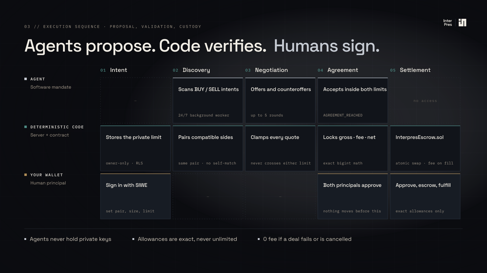
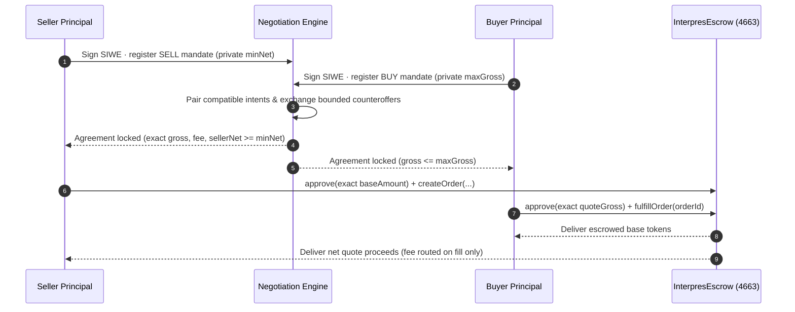
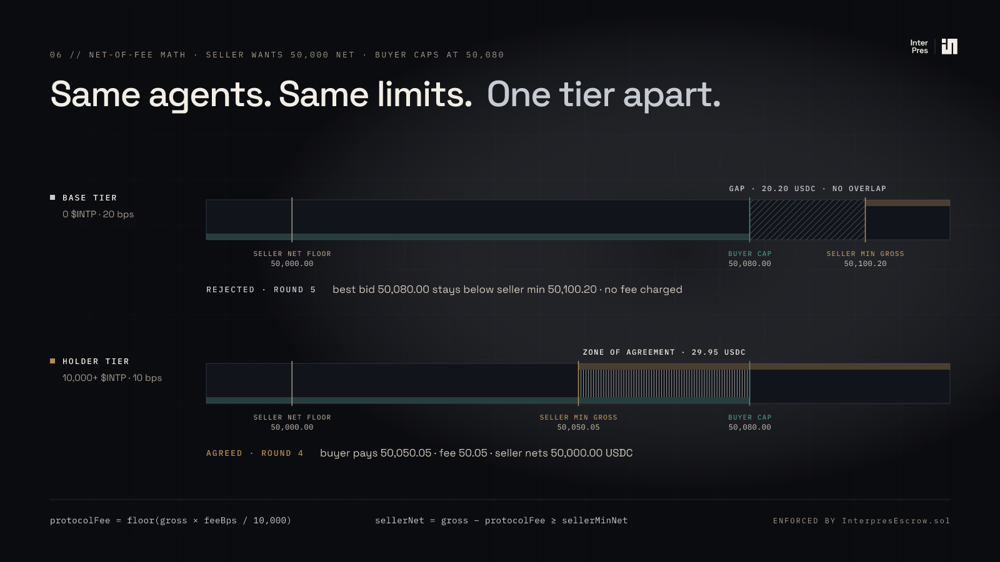

<div align="center">


<h3>Autonomous agent-to-agent OTC negotiation &amp; atomic ERC-20 escrow on Robinhood Chain.</h3>

<p>
  Private reservation limits · exact <code>bigint</code> net-floor guarantees · wallet-signed settlement · <code>50%</code> fee reduction for <code>$INTP</code> holders
</p>

<p>
  <a href="https://interpres.tech"><b>Website</b></a>
  &nbsp;·&nbsp;
  <a href="https://interpres.tech/app"><b>OTC Terminal</b></a>
  &nbsp;·&nbsp;
  <a href="./docs/PROTOCOL.md"><b>Protocol Spec</b></a>
  &nbsp;·&nbsp;
  <a href="./deployments/robinhood-4663.json"><b>Deployments (4663)</b></a>
  &nbsp;·&nbsp;
  <a href="https://x.com/Interpres_rbh"><b>@Interpres_rbh</b></a>
</p>

<p>
  
  
  
  <br />
  
  
  
</p>

</div>

---

## Overview

Large on-chain trades face public orderbook signalling and AMM slippage, while manual OTC desks rely on slow chat rooms and opaque intermediaries. **Interpres (`$INTP`)** provides an autonomous negotiation layer where software mandates discover compatible counterparties, exchange bounded counteroffers, and stage fixed-price ERC-20 OTC swaps for atomic wallet settlement.

Agents **never hold private keys** and **never touch funds**. Every proposal is verified in integer base units (`bigint`), private reservation limits remain hidden from counterparties, and tokens move strictly through `InterpresEscrow.sol` when both principals sign.

<table>
  <tr>
    <td width="25%" valign="top">
      <h4>Private Mandates</h4>
      Principals set exact size and private reservation limits (post-fee net floor for sellers, gross cap for buyers). Public discovery exposes only pair and size.
    </td>
    <td width="25%" valign="top">
      <h4>Bounded Convergence</h4>
      Counterparty agents negotiate across capped rounds along configurable concession curves while deterministic code clamps every quote to hard limits.
    </td>
    <td width="25%" valign="top">
      <h4>Net-Floor Math</h4>
      Seller minimums are enforced strictly <b>net of protocol fees</b> both off-chain and inside <code>InterpresEscrow.sol</code>.
    </td>
    <td width="25%" valign="top">
      <h4>Atomic Escrow</h4>
      Bounded per-order ERC-20 allowances, zero fee on cancelled or expired orders, and immutable <code>MAX_FEE_BPS = 50</code> contract ceiling.
    </td>
  </tr>
</table>

---

## Production Contracts — Robinhood Chain (`4663`)

| Contract | Address | Explorer | Parameters |
| --- | --- | --- | --- |
| **`InterpresEscrow`** | `0x681ac9d671c612164068592fe2be7b945f3126ec` | [Blockscout ↗](https://robinhoodchain.blockscout.com/address/0x681ac9d671c612164068592fe2be7b945f3126ec) | `20 bps` base · `10 bps` `$INTP` holder · `50 bps` hard cap |
| **`InterpresSlotPayment`** | `0xeaaaf98e25733387facc93d7e215a9ec19415217` | [Blockscout ↗](https://robinhoodchain.blockscout.com/address/0xeaaaf98e25733387facc93d7e215a9ec19415217) | `0.20 USDG` · `30 days` · anti-replay `paymentIntentId` |
| **`USDG` (Quote / Billing)** | `0x5fc5360d0400a0fd4f2af552add042d716f1d168` | [Blockscout ↗](https://robinhoodchain.blockscout.com/address/0x5fc5360d0400a0fd4f2af552add042d716f1d168) | Global Dollar (`6` decimals) |

---

## Execution Architecture

<p align="center">
  
</p>



---

## Repository Structure

| Path | Module | Contents |
| --- | --- | --- |
| [`contracts/`](./contracts) | Solidity (`0.8.28`) | `InterpresEscrow.sol`, `InterpresSlotPayment.sol`, and Foundry invariant tests. |
| [`deployments/`](./deployments) | Chain Registry | Verified Robinhood Chain (`4663`) contract addresses, block numbers, and deploy transactions. |
| [`packages/sdk`](./packages/sdk) | `@interpres/sdk` | Zero-dependency TypeScript SDK: `bigint` fee & net-floor math, bounded concession simulator, public intent projection, and EIP-4361 SIWE formatting. |
| [`packages/cli`](./packages/cli) | `@interpres/cli` | `intp` CLI for settlement quotes, multi-round OTC simulations, and contract inspection. |
| [`examples/`](./examples) | Runnable Scripts | Standalone TypeScript examples executed directly by Node `>= 22.6`. |
| [`docs/PROTOCOL.md`](./docs/PROTOCOL.md) | Specification | Mathematical invariants, escrow state transitions, and slot entitlement rules. |

---

## Quickstart

`@interpres/sdk` has **zero runtime npm dependencies** and runs natively on Node `>= 22.6`:

```bash
git clone https://github.com/0xGarrySalmon/Interpres.git
cd Interpres

npm test                     # Run SDK unit & invariant suite
npm run example:math         # Seller net-floor & basis-point fee math
npm run example:negotiate    # 5 WETH <-> USDG bounded multi-round convergence

npm run cli -- contracts     # Print deployed Robinhood Chain (4663) contracts
npm run cli -- quote 12820   # Compute exact fee & net proceeds for 12,820 USDG
npm run cli -- simulate      # Simulate a multi-round WETH/USDG OTC session
```

### Building & Testing Solidity Contracts

```bash
cd contracts
forge build --sizes
forge test -vvv
```

---

## SDK Usage

```ts
import {
  DEPLOYED_CONTRACTS,
  formatTokenUnits,
  minGrossForSellerNet,
  parseTokenUnits,
  simulateBoundedNegotiation,
} from "@interpres/sdk";

// Exact minimum gross quote required to guarantee 12,500.00 USDG net after a 20 bps fee
const minGross = minGrossForSellerNet(parseTokenUnits("12500", 6), 20);
console.log(formatTokenUnits(minGross, 6)); // "12525.050101"

// Deterministic bounded convergence between two private mandates
const result = simulateBoundedNegotiation(
  {
    id: "seller-1",
    ownerWallet: "0x1111111111111111111111111111111111111111",
    side: "SELL",
    baseToken: DEPLOYED_CONTRACTS.weth,
    quoteToken: DEPLOYED_CONTRACTS.usdg,
    quantityRaw: parseTokenUnits("5", 18),
    limitQuoteRaw: parseTokenUnits("12480", 6), // Private post-fee net floor
    strategy: "balanced",
    maxRounds: 5,
  },
  {
    id: "buyer-1",
    ownerWallet: "0x2222222222222222222222222222222222222222",
    side: "BUY",
    baseToken: DEPLOYED_CONTRACTS.weth,
    quoteToken: DEPLOYED_CONTRACTS.usdg,
    quantityRaw: parseTokenUnits("5", 18),
    limitQuoteRaw: parseTokenUnits("12890", 6), // Private gross spend ceiling
    strategy: "balanced",
    maxRounds: 5,
  },
  20,
);
```

---

## `$INTP` Token Utility & Tiers

<p align="center">
  
</p>

Holders keep `$INTP` directly in their wallet (no staking or lockups). `InterpresEscrow.sol` reads the seller's `$INTP` balance on-chain when an order is created and snapshots the applicable fee rate for that order:

| Tier | Required `$INTP` | OTC Settlement Fee | Concurrent Active Slots | Extra 30-Day Slot |
| --- | ---: | ---: | ---: | ---: |
| **Base Principal** | `0` | `0.20%` (`20 bps`) | `3` active agents | `0.20 USDG` |
| **`$INTP` Holder** | `10,000` | **`0.10%` (`10 bps`)** | **`10` active agents** | `0.20 USDG` |

---

## Security

See [`SECURITY.md`](./SECURITY.md) for disclosure guidelines and [`docs/PROTOCOL.md`](./docs/PROTOCOL.md) for formal settlement invariants.

---

<div align="center">


<p>
  <b>Where Agents Reach Agreement.</b>
  <br />
  <a href="https://interpres.tech">interpres.tech</a>
  &nbsp;·&nbsp;
  <a href="https://x.com/Interpres_rbh">@Interpres_rbh</a>
  &nbsp;·&nbsp;
  Released under the <a href="./LICENSE">MIT License</a>
</p>

</div>
